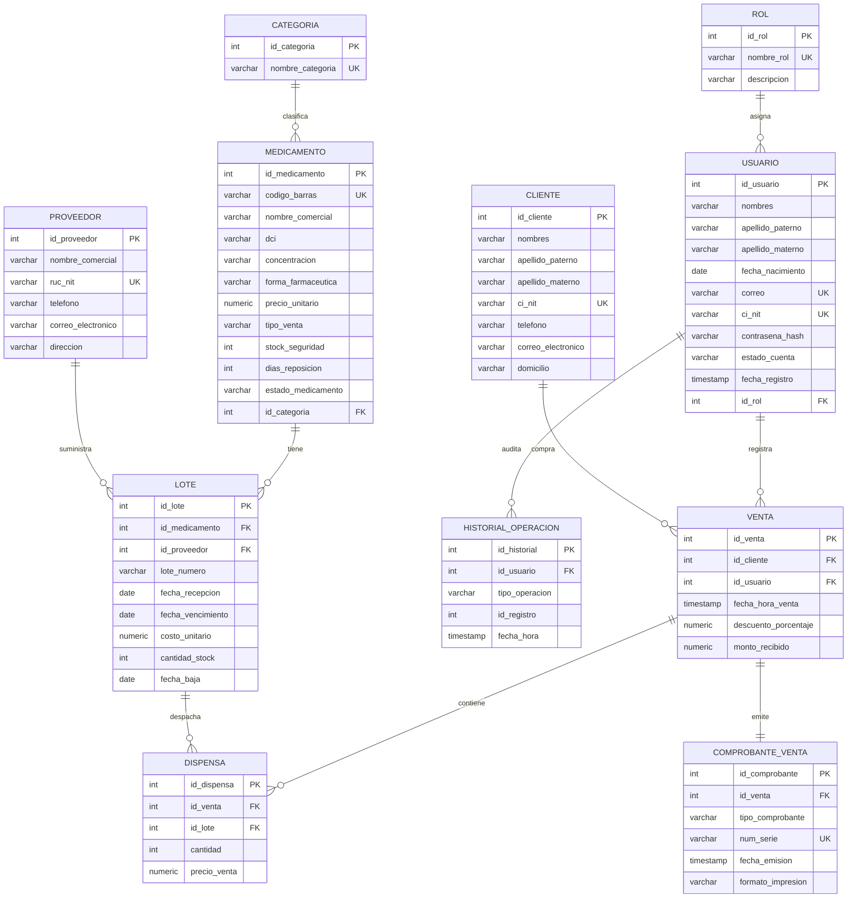
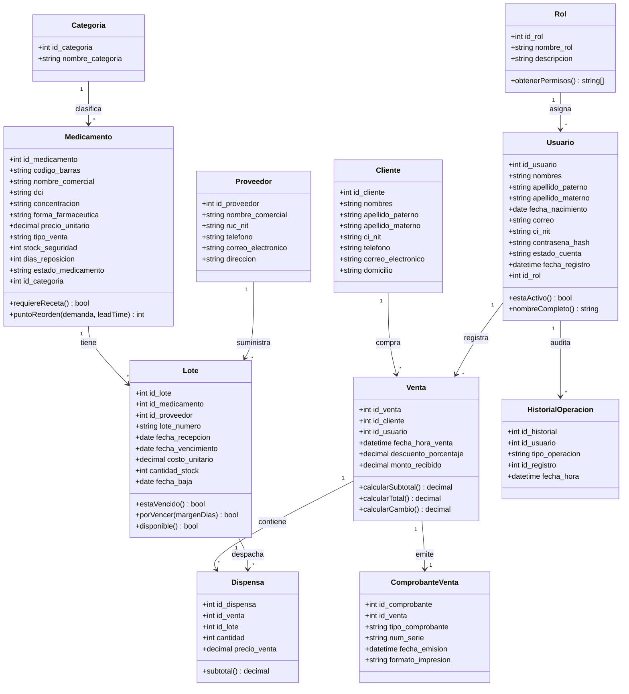

# Modelo de datos (capa de datos)

Este documento corresponde al punto **13.3 Capa de datos: modelo E/R, diagrama de clases y diseño de la base de datos**.

> **Importante:** el esquema real vive en `database/01_init.sql` y `database/02_inserts.sql`. En esta reestructuración **no se modificó ningún archivo de `database/`**. Todo lo que sigue documenta ese esquema y ubica cada regla en la capa que le corresponde.

---

## 1. Modelo entidad–relación

### Relaciones y cardinalidades

| Relación | Cardinalidad | Implementación |
|---|---|---|
| Rol – Usuario | 1 : N | `usuario.id_rol` |
| Categoría – Medicamento | 1 : N | `medicamento.id_categoria` |
| Medicamento – Lote | 1 : N | `lote.id_medicamento` |
| Proveedor – Lote | 1 : N | `lote.id_proveedor` |
| Cliente – Venta | 1 : N | `venta.id_cliente` |
| Usuario – Venta | 1 : N | `venta.id_usuario` |
| Venta – Dispensa | 1 : N | `dispensa.id_venta` |
| Lote – Dispensa | 1 : N | `dispensa.id_lote` |
| Venta – Comprobante | 1 : 1 | `comprobante_venta.id_venta UNIQUE` |
| Usuario – Historial | 1 : N | `historial_operacion.id_usuario` |

La tabla `dispensa` resuelve la relación **N : M entre Venta y Lote**, con los atributos propios de la relación: `cantidad` y `precio_venta`.

`historial_operacion.id_registro` es una referencia **polimórfica** (apunta a una venta o a un lote según `tipo_operacion`), por eso no tiene clave foránea.

---

## 2. Diagrama de clases

El diagrama representa las clases del dominio y las reglas que la capa de negocio implementa sobre ellas. En el código actual los datos viajan como objetos planos mapeados desde SQL; las clases muestran el modelo conceptual que los servicios respetan.

### Métodos y su ubicación en el código

| Método conceptual | Implementación actual |
|---|---|
| `Usuario.estaActivo()` | `estado_cuenta === 'Activo'` en `auth.service.js` |
| `Usuario.nombreCompleto()` | `data/mappers/user.mapper.js` |
| `Rol.obtenerPermisos()` | `business/rules/permissions.js` |
| `Medicamento.requiereReceta()` | `tipo_venta === 'Con receta'` (regla de ventas, futura) |
| `Medicamento.puntoReorden()` | `ROP = (D × L) + SS` (regla de inventario, futura) |
| `Lote.estaVencido()` / `porVencer()` | Regla de inventario/ventas, futura |
| `Venta.calcularTotal()` | Regla de ventas, futura |
| `Dispensa.subtotal()` | `cantidad × precio_venta` |

---

## 3. Diccionario de datos

### `rol`

| Columna | Tipo | Restricción |
|---|---|---|
| `id_rol` | `SERIAL` | PK |
| `nombre_rol` | `VARCHAR(50)` | NOT NULL, UNIQUE |
| `descripcion` | `VARCHAR(150)` | — |

### `usuario`

| Columna | Tipo | Restricción |
|---|---|---|
| `id_usuario` | `SERIAL` | PK |
| `nombres` | `VARCHAR(80)` | NOT NULL |
| `apellido_paterno` | `VARCHAR(60)` | NOT NULL |
| `apellido_materno` | `VARCHAR(60)` | — |
| `fecha_nacimiento` | `DATE` | NOT NULL |
| `correo` | `VARCHAR(120)` | NOT NULL, UNIQUE |
| `ci_nit` | `VARCHAR(20)` | NOT NULL, UNIQUE |
| `contrasena_hash` | `VARCHAR(100)` | NOT NULL (bcrypt, coste 12) |
| `estado_cuenta` | `VARCHAR(10)` | NOT NULL, `Activo` / `Inactivo` |
| `fecha_registro` | `TIMESTAMP` | NOT NULL, default `CURRENT_TIMESTAMP` |
| `id_rol` | `INT` | NOT NULL, FK → `rol` |

### `categoria`

| Columna | Tipo | Restricción |
|---|---|---|
| `id_categoria` | `SERIAL` | PK |
| `nombre_categoria` | `VARCHAR(60)` | NOT NULL, UNIQUE |

### `medicamento`

| Columna | Tipo | Restricción |
|---|---|---|
| `id_medicamento` | `SERIAL` | PK |
| `codigo_barras` | `VARCHAR(20)` | NOT NULL, UNIQUE |
| `nombre_comercial` | `VARCHAR(100)` | NOT NULL |
| `dci` | `VARCHAR(100)` | NOT NULL |
| `concentracion` | `VARCHAR(40)` | NOT NULL |
| `forma_farmaceutica` | `VARCHAR(20)` | NOT NULL, catálogo cerrado |
| `precio_unitario` | `NUMERIC(10,2)` | NOT NULL, ≥ 0 |
| `tipo_venta` | `VARCHAR(15)` | NOT NULL, `Libre` / `Con receta` |
| `stock_seguridad` | `INT` | NOT NULL, ≥ 0 |
| `dias_reposicion` | `INT` | NOT NULL, ≥ 0 |
| `estado_medicamento` | `VARCHAR(10)` | NOT NULL, `Activo` / `Inactivo` |
| `id_categoria` | `INT` | NOT NULL, FK → `categoria` |

### `proveedor`

| Columna | Tipo | Restricción |
|---|---|---|
| `id_proveedor` | `SERIAL` | PK |
| `nombre_comercial` | `VARCHAR(100)` | NOT NULL |
| `ruc_nit` | `VARCHAR(20)` | NOT NULL, UNIQUE |
| `telefono` | `VARCHAR(20)` | — |
| `correo_electronico` | `VARCHAR(120)` | — |
| `direccion` | `VARCHAR(150)` | — |

### `lote`

| Columna | Tipo | Restricción |
|---|---|---|
| `id_lote` | `SERIAL` | PK |
| `id_medicamento` | `INT` | NOT NULL, FK → `medicamento` |
| `id_proveedor` | `INT` | NOT NULL, FK → `proveedor` |
| `lote_numero` | `VARCHAR(40)` | NOT NULL |
| `fecha_recepcion` | `DATE` | NOT NULL, default `CURRENT_DATE` |
| `fecha_vencimiento` | `DATE` | NOT NULL, > `fecha_recepcion` |
| `costo_unitario` | `NUMERIC(10,2)` | NOT NULL, ≥ 0 |
| `cantidad_stock` | `INT` | NOT NULL, ≥ 0 |
| `fecha_baja` | `DATE` | — |

Restricción adicional: `UNIQUE (id_medicamento, lote_numero)`.

### `cliente`

| Columna | Tipo | Restricción |
|---|---|---|
| `id_cliente` | `SERIAL` | PK |
| `nombres` | `VARCHAR(80)` | NOT NULL |
| `apellido_paterno` | `VARCHAR(60)` | — |
| `apellido_materno` | `VARCHAR(60)` | — |
| `ci_nit` | `VARCHAR(20)` | NOT NULL, UNIQUE |
| `telefono` | `VARCHAR(20)` | — |
| `correo_electronico` | `VARCHAR(120)` | — |
| `domicilio` | `VARCHAR(150)` | — |

### `venta`

| Columna | Tipo | Restricción |
|---|---|---|
| `id_venta` | `SERIAL` | PK |
| `id_cliente` | `INT` | NOT NULL, FK → `cliente` |
| `id_usuario` | `INT` | NOT NULL, FK → `usuario` |
| `fecha_hora_venta` | `TIMESTAMP` | NOT NULL, default `CURRENT_TIMESTAMP` |
| `descuento_porcentaje` | `NUMERIC(5,2)` | NOT NULL, entre 0 y 100 |
| `monto_recibido` | `NUMERIC(10,2)` | NOT NULL, ≥ 0 |

### `dispensa`

| Columna | Tipo | Restricción |
|---|---|---|
| `id_dispensa` | `SERIAL` | PK |
| `id_venta` | `INT` | NOT NULL, FK → `venta` |
| `id_lote` | `INT` | NOT NULL, FK → `lote` |
| `cantidad` | `INT` | NOT NULL, > 0 |
| `precio_venta` | `NUMERIC(10,2)` | NOT NULL, ≥ 0 |

Restricción adicional: `UNIQUE (id_venta, id_lote)`.

### `comprobante_venta`

| Columna | Tipo | Restricción |
|---|---|---|
| `id_comprobante` | `SERIAL` | PK |
| `id_venta` | `INT` | NOT NULL, UNIQUE, FK → `venta` |
| `tipo_comprobante` | `VARCHAR(15)` | NOT NULL, `Nota de venta` / `Factura` |
| `num_serie` | `VARCHAR(30)` | NOT NULL, UNIQUE |
| `fecha_emision` | `TIMESTAMP` | NOT NULL, default `CURRENT_TIMESTAMP` |
| `formato_impresion` | `VARCHAR(10)` | NOT NULL, `Pantalla` / `Impreso` |

### `historial_operacion`

| Columna | Tipo | Restricción |
|---|---|---|
| `id_historial` | `SERIAL` | PK |
| `id_usuario` | `INT` | NOT NULL, FK → `usuario` |
| `tipo_operacion` | `VARCHAR(15)` | NOT NULL, `VENTA` / `RECEPCION` / `BAJA` |
| `id_registro` | `INT` | NOT NULL (referencia polimórfica) |
| `fecha_hora` | `TIMESTAMP` | NOT NULL, default `CURRENT_TIMESTAMP` |

---

## 4. Reglas de dominio y su capa

| Regla | Descripción | Dónde se implementa |
|---|---|---|
| RD1 | Conservar lote y proveedor en cada entrada y salida | `dispensa` → `lote` → `proveedor` (datos) |
| RD3 | Medicamento con DCI, concentración y forma farmacéutica | Restricciones `NOT NULL` (datos) + validación (presentación) |
| RD4 | Punto de reorden `ROP = (D × L) + SS` | `business/rules/` (inventario, futuro) |
| RD5 | Receta obligatoria para `tipo_venta = 'Con receta'` | `business/services/sales.service.js` (futuro) |
| — | Stock nunca negativo | `CHECK (cantidad_stock >= 0)` + transacción en el servicio |
| — | No vender lotes vencidos | Regla de negocio + `fecha_vencimiento` (datos) |
| — | Una cuenta no puede desactivarse a sí misma | `business/rules/users.rules.js` |
| — | Un administrador no puede quitarse el rol | `business/rules/users.rules.js` |
| — | Contraseñas con bcrypt (coste 12) | `business/security/passwords.js` |
| — | Permisos por rol | `business/rules/permissions.js` |

---

## 5. Diseño de la base de datos

- **Normalización:** el esquema está en tercera forma normal (3FN). Cada tabla tiene una clave primaria simple, los atributos dependen de ella y las relaciones N:M se resuelven con tablas intermedias (`dispensa`).
- **Integridad:** claves foráneas en todas las relaciones, `UNIQUE` en correo, CI/NIT, código de barras, RUC/NIT, número de lote por medicamento y número de serie del comprobante.
- **Dominio:** `CHECK` para estados, tipos, precios, stock y descuentos.
- **Borrado lógico:** las entidades con estado pasan a `Inactivo`; los movimientos (`venta`, `dispensa`, `comprobante_venta`, `historial_operacion`) no se modifican ni se eliminan.
- **Transacciones:** las operaciones que afectan varias tablas (venta + dispensa + stock, recepción + stock + historial) deben ejecutarse con `data/connection.js → conTransaccion()`.
- **Índices:** las claves primarias y `UNIQUE` ya crean índices. Para reportes conviene evaluar índices sobre `lote.fecha_vencimiento`, `venta.fecha_hora_venta` y `usuario.correo`; **no se aplicaron cambios** porque el esquema no se modifica en esta entrega.

---

## 6. Correspondencia con el código

| Elemento del modelo | Archivo |
|---|---|
| `usuario`, `rol` | `backend/data/repositories/users.repository.js`, `roles.repository.js` |
| Mapeo de filas | `backend/data/mappers/user.mapper.js` |
| Conexión y transacciones | `backend/data/connection.js` |
| Reglas de usuario | `backend/business/rules/users.rules.js` |
| Permisos | `backend/business/rules/permissions.js` |
| Casos de uso | `backend/business/services/` |

Los módulos de inventario, ventas y reportes seguirán el mismo patrón: un repositorio por entidad, un servicio por caso de uso y un controlador por recurso.
